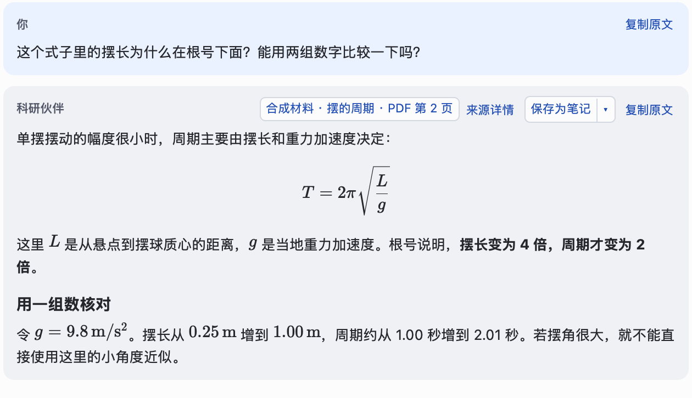

# Research Companion · 科研助手

Research Companion 是一款免费开源的 macOS 文献阅读助手。把 PDF、文本文件或一段选中的原文带进科研窗口，结合材料提问，再把回答和公式存成 Markdown 笔记。模型与会话由你自己安装的 DeepSeek Harness Desktop（DSH）提供。

## 下载和安装

当前下载版本为 **v0.2.9 Community Beta（构建 21）**。安装包只验证了 Apple Silicon（arm64）。macOS 14.0 是部署目标，尚未在 macOS 14 实机上验收。发行包内的 App 使用 ad hoc 签名，未经 Apple 公证。

1. 到发行页的 **Assets** 下载 `ResearchCompanion-0.2.9-arm64.dmg` 和同名 `.sha256` 文件，将两者放在同一目录。[v0.2.9 下载与发行说明](https://github.com/mxk021/ResearchCompanion/releases/tag/v0.2.9)
2. 在该目录打开终端，运行 `shasum -a 256 -c ResearchCompanion-0.2.9-arm64.dmg.sha256`。看到 `OK` 后打开 DMG，把 **Research Companion** 拖入「应用程序」，从那里双击启动。若 macOS 提示无法验证开发者，请先核实来源，再按安装指南为这个 App 手动允许首次打开。[安装指南](docs/SETUP.md)
3. 另行安装兼容的 **DSH Desktop 0.2.2-rc.5**，首次启动 DSH 后正常退出。在科研助手的「连接设置」中点「安装科研桥」，再打开 DSH，配置自己的模型账号。选一份 PDF 或 Markdown，检查读取范围和模型后就可以提问。[DSH 官方下载](https://www.deepseek.com/harness/)

## 阅读和写笔记

- 从支持的阅读应用选中文字，使用「选取文字」预览；默认 **⌃⌥T** 直接翻译。系统服务可接收当前应用传入的选区。浏览器、受保护内容与阅读器的支持取决于它们是否提供可读选区。
- 文本型 PDF 会按页提取，问答使用相关页段；扫描页可按需进行本机 OCR。回答旁的材料入口可以核对当轮摘录，有可靠位置时可返回原文。
- Markdown 与 LaTeX 在本机渲染。聚焦回答后，用 **⌥⌘S** 将回答或选中的公式保存为笔记，**⌥⌘O** 返回来源。历史可按标题、材料与归档状态查找。

## 依赖与数据

- **模型账号**由你自行配置。发送问题或触发选区翻译时，相关材料会交给 DSH 中选定的提供方，费用与额度取决于你的账号。安装包不附带模型账号、ChatGPT 私人订阅适配器或授权。
- **会话历史**支持检索和归档。标准 DSH 可能不提供永久删除，只有宿主明确支持时才能使用。导出的 Markdown 笔记保存在你选择的目录。
- **Zotero** 是可选项。如需从 Zotero 10 主窗口读取当前论文的选区，可安装 DMG 中的扩展。直接打开 PDF 或 Markdown 无需安装 Zotero。[安装与权限说明](docs/SETUP.md)

## 参与开发

欢迎提交可复现的问题、文档修正和代码改进。报告问题时请用合成材料复现，并删去账号、凭据、私人路径及论文内容。[报告问题](https://github.com/mxk021/ResearchCompanion/issues/new?template=bug_report.md) · [贡献指南](CONTRIBUTING.md) · [构建与测试](docs/BUILD.md)

Research Companion 是独立项目，与 DSH、OpenAI 和 Zotero 无官方隶属关系。项目自身代码采用 MIT 许可证，随包字体与第三方组件保留各自的声明。[MIT 许可证](LICENSE) · [第三方来源与许可](docs/THIRD_PARTY.md) · [版本记录](CHANGELOG.md)
